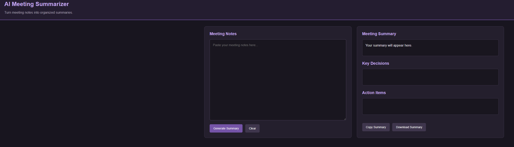
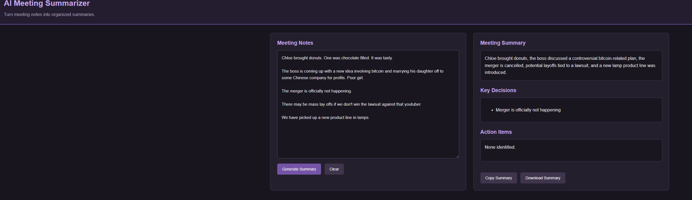

# AI Meeting Summarizer

## Project Overview

The AI Meeting Summarizer is a web application that uses
artificial intelligence to summarize meeting notes and
transcripts. It helps users quickly identify important
information, decisions, and action items without having
to manually review lengthy meeting notes.

## Features

- AI generated meeting summaries.
- Identification of important decisions.
- Extraction of action items and deadlines.
- Identification of assigned responsibilities.
- Copy generated summaries to the clipboard.
- Download summaries as text files.
- Input validation and error handling.
- Responsive interface with a dark purple theme.

## Installation Instructions

1. Clone this repository or open it using GitHub Codespaces.
2. Install the required Python packages:

   pip install -r requirements.txt

3. Create an API key through the Groq website.
4. Store the API key as an environment variable named
   GROQ_API_KEY.
5. Start the application:

   python app.py

6. Open the application through port 5000.

## Usage Guide

1. Open the application.
2. Enter or paste meeting notes into the text box.
3. Click Generate Summary.
4. Review the meeting summary, decisions, and action items.
5. Copy or download the generated results if needed.
6. Click Clear to start another summary.

## Screenshots

### Application Interface

### Generated Meeting Summary

## Technologies Used

- Python
- Flask
- HTML
- CSS
- JavaScript
- Groq API
- GPT-OSS 20B
- GitHub
- GitHub Codespaces

## Future Enhancements

- Upload meeting transcripts directly from files.
- Support audio transcription.
- Save previous meeting summaries.
- Allow users to customize summary length.
- Export summaries as PDF documents.

## AI Assisted Development

ChatGPT was used throughout the development process
to assist with planning, coding, interface design,
debugging, testing, and documentation.